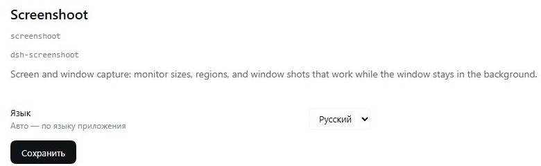

# dsh-screenshoot

A DSH plugin for screen and window captures. Cross-platform: Windows, macOS, Linux (X11).

The main difference from an ordinary "screen screenshot": a window is captured **by its own
pixels**, so the shot works even if the window is behind another window, minimized in the
background or out of focus. A movie in the foreground and the agent's app behind it are not
a problem.

## Tools

| Tool | What it does |
|---|---|
| `screen_monitors` | list of monitors: position, size, scale, primary |
| `screen_windows` | visible windows: id, pid, title, process, position, size |
| `screen_capture_monitor` | capture of a whole monitor |
| `screen_capture_region` | capture of a rectangular region |
| `screen_capture_window` | capture of a window by `pid`, `title` or `id` (decimal or `0x…`) |

A region is clipped to the virtual desktop bounds: if it goes beyond the screen, the shot is
taken over the intersection and `clamped` appears in the caption, and if there is no
intersection at all, a clear error with the desktop dimensions is returned.

All three captures have `delayMs` — wait before the shot (up to 30 s). Useful when a menu
opens, an animation is playing, or the window has not repainted yet.

All shots are saved as PNG and the path is returned in the result — it can be opened with the
`read_image` tool to look at the picture.

## Window crop

A window can be captured not whole but with a rectangle cut out relative to its top-left
corner:

```text
screen_capture_window { pid: 11184, crop: { x: 40, y: 60, width: 420, height: 240 } }
→ window 420×240 … · crop 420×240 at 40,60
```

Coordinates are counted from the window corner (the top-left point of the content), not from
the screen. If the rectangle goes beyond the shot, an error with the picture dimensions is
returned — we will not silently clip to the edge.

Cropping works on every platform: the shot is taken the platform way, then the PNG is cropped
by the built-in decoder (`src/png.js`), without ImageMagick and without external dependencies.

## Shots in chat

Like in Browser: after a shot a thumbnail appears in the tool row. The host raises a local
frame server on `127.0.0.1:49231`, the tool returns a `[shot:<id>]` marker, and the client
renders an `` from it. The last 24 frames are kept in memory; the files stay on disk.

Clicking a thumbnail opens the PNG in a new tab.

## How it works per platform

**Windows** — PowerShell + Win32:

- `EnumWindows` + `DwmGetWindowAttribute` — window list and exact bounds;
- `PrintWindow(PW_RENDERFULLCONTENT)` — rendering the window into a bitmap instead of copying
  the screen; that is exactly why an occluded window is captured;
- `Graphics.CopyFromScreen` — monitor and region;
- per-monitor DPI awareness — coordinates and sizes in physical pixels (important at 200 %).
- Window titles are passed as base64, and stdout is forced to UTF-8 — otherwise Cyrillic breaks.

**macOS** — `screencapture` + JavaScript for Automation:

- `NSScreen` — monitors;
- `CGWindowListCopyWindowInfo` — windows and their bounds;
- `screencapture -l <window id>` — a window, even an occluded one; `-R` — region; `-D` — monitor.

The **Screen Recording** permission is required (System Settings → Privacy). Without it macOS
will only give the wallpaper.

**Linux (X11)** — `xrandr`, `wmctrl`, ImageMagick `import`:

- `xrandr --query` — monitors;
- `wmctrl -lGpx` — windows, pid and geometry;
- `import -window <id>` — the window from its own buffer; `-window root -crop` — region.

On Wayland the X11 tools do not see windows: the plugin will honestly say what is missing
instead of a black shot. Wayland needs a portal/grim approach.

## Screenshots



## Installation

```bash
dsh plugin --profile desktop add @machine202502/dsh-screenshoot
```

or manually: add to `~/.dsh/profiles/desktop/package.json`

```json
{
  "dependencies": { "@machine202502/dsh-screenshoot": "^0.1.1" },
  "dsh": { "profile": { "bundles": ["…", "@machine202502/dsh-screenshoot"] } }
}
```

and restart DSH. The plugin pulls no npm dependencies — only the platform's system tools.

## Languages

Interface languages: Russian, English, Chinese.

The interface language comes from the `language` extension setting when it is `ru`, `en` or
`zh`. The value `auto` follows the application language: `document.documentElement.lang`, then
`navigator.language`; `ru*` → `ru`, `zh*` → `zh`, otherwise `en`. With no setting at all the
default is `ru`.

The setting is changed in the plugin form **Plugins → Screenshoot** and stored in the file
`%LOCALAPPDATA%\dsh-screenshoot\settings.json`.

## Examples

```text
screen_monitors
→ 0* 3200x2000 at 0,0

screen_windows { title: "Brave" }
→ 132518  pid 9800  3200x1904 at 0,0  machine202502/dsh-browser – Brave

screen_capture_window { title: "Brave" }
→ path to PNG 3200x1904 (the window was behind DSH)

screen_capture_region { x: 100, y: 100, width: 800, height: 500 }
screen_capture_monitor { monitor: 0 }
```

## Requirements

| Platform | What is needed |
|---|---|
| Windows | PowerShell 5.1+ (present by default), .NET Framework |
| macOS | Screen Recording permission |
| Linux X11 | `xrandr`, `wmctrl`, ImageMagick (`import`) |
| Linux Wayland | `grim`, `wlr-randr` (monitor/region only) |

## Testing

```bash
node tests/probe.mjs   # the platform backend directly
node tests/smoke.mjs   # the tools through index.js
```
